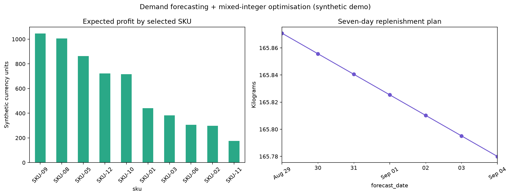
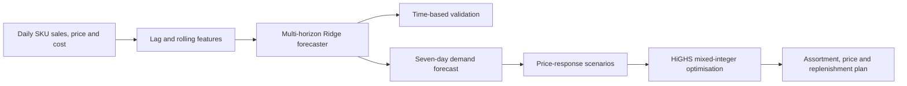

<div align="center">

# Vegetable Pricing & Replenishment

**Leakage-aware demand forecasting and exact pricing/replenishment optimisation**

A 2026 reimplementation inspired by a 2023 mathematical modelling project

[](#quickstart)
[](#method)
[](#optimisation-model)
[](#verified-demo-results)
[](https://github.com/Cjj040721/Vegetable-Pricing-Replenishment/actions/workflows/smoke.yml)

[Quickstart](#quickstart) · [Method](#method) · [Verified Results](#verified-demo-results) · [Input Data](#input-data)

</div>

---

## What This Project Does

Given daily SKU-level sales, prices, and costs, this project:

1. builds multi-horizon demand features without looking into the future;
2. evaluates forecasting against a seasonal-naive baseline on a time-based holdout;
3. forecasts demand for the next seven days;
4. evaluates three price scenarios per SKU using a price-elasticity model;
5. solves the assortment, pricing, and replenishment decisions with **mixed-integer linear programming**.

The original competition idea is retained, but the implementation is new. The 2023 report is kept only as a [historical reference](references/2023-report.pdf).



## What Changed in the 2026 Version

| Area | New implementation |
| --- | --- |
| Validation | Time-based holdout with a seven-day embargo between training and validation origins |
| Forecasting | One regularised multi-SKU, multi-horizon model with lag, rolling, calendar, price, and cost features |
| Baseline | Seasonal-naive forecast reported alongside MAE, RMSE, and WAPE |
| Pricing | Explicit price scenarios and demand response instead of price-independent replenishment |
| Optimisation | Exact MILP through SciPy/HiGHS with assortment and minimum-display constraints |
| Evidence | Reproducible synthetic demo, saved forecasts, selected decisions, solver status, and figure |

## Quickstart

Requires Python 3.11 or newer. Verified with Python 3.12.

```bash
python3.12 -m venv .venv
source .venv/bin/activate
pip install -e .

veg-demo --output data/demo_sales.csv
veg-optimize --data data/demo_sales.csv --output outputs
```

Optional parameters:

```bash
veg-optimize \
  --data data/demo_sales.csv \
  --output outputs \
  --validation-days 28 \
  --min-skus 6 \
  --max-skus 10 \
  --elasticity 2.2
```

Generated files:

```text
outputs/
├── demand_forecast.csv
├── replenishment_plan.csv
├── summary.json
└── demo_report.png
```

## Verified Demo Results

The following results come from an actual run of the included deterministic **synthetic-data generator**. They are software-verification results, not historical retail performance or results from the 2023 report.

### Time-based validation

- Validation targets: 2–28 August 2025
- Validation samples: **2,016**
- Forecast horizon: **1–7 days**

| Metric | Ridge demand model | Seasonal-naive baseline |
| --- | ---: | ---: |
| MAE | **2.2381** | 2.9653 |
| RMSE | **2.9222** | — |
| WAPE | **14.83%** | 19.65% |

The demo run reduced MAE by **24.5%** relative to the seasonal-naive baseline.

### Optimisation

- Solver: **HiGHS**, optimal status
- Plan: **70 SKU-day decisions** across seven days
- Price scenarios selected: 14 at `0.95×`, 14 at `1.00×`, and 42 at `1.05×`
- Total planned replenishment: **1,160.78 kg**
- Modelled expected profit: **5,957.48 synthetic currency units**

The generated plan was also checked to confirm:

- 6–10 distinct SKUs selected per day;
- no duplicate SKU/day decision;
- replenishment of at least 2.5 kg for every selected item;
- finite prices, demand estimates, quantities, and profit values.

## Method



### Forecasting

For every SKU and forecast origin, the model uses only information available at that origin:

- previous-day and seven-day lagged sales;
- shifted seven-day rolling mean and standard deviation;
- SKU and category identity;
- day of week, month, price, and cost;
- forecast horizon from one to seven days.

A seven-day embargo prevents training targets from crossing into the validation-origin period. The final forecaster is refitted on all fully observed samples before producing the future plan.

## Optimisation Model

For each SKU/day, the optimiser considers `0.95×`, `1.00×`, and `1.05×` price scenarios.

```text
adjusted demand = forecast demand × price factor^(-elasticity)
replenishment   = max(adjusted demand, minimum display quantity)
waste           = replenishment - adjusted demand
expected profit = adjusted demand × (price - cost) - waste × cost
```

Binary decision variables select at most one price scenario per SKU/day. Daily constraints enforce the requested assortment-size range. The default elasticity is `2.2` and is configurable from the CLI.

## Input Data

Provide a CSV with one complete daily row per SKU:

| Column | Meaning |
| --- | --- |
| `date` | Observation date |
| `sku` | Unique SKU identifier |
| `category` | Product category |
| `units_sold` | Non-negative daily sales quantity |
| `unit_price` | Non-negative selling price |
| `unit_cost` | Non-negative unit cost |

The demo generator creates 2,880 rows for 12 SKUs over 240 days. It uses fixed random seed `42` and is intended only for reproducible software demonstration.

## Project Structure

```text
src/veg_pricing/
├── demo.py          # Deterministic synthetic-data generator
├── features.py      # Leakage-aware lag and horizon features
├── forecast.py      # Training, baseline evaluation, final forecast
├── optimise.py      # Price scenarios and MILP decisions
├── reporting.py     # Reproducible result figure
└── pipeline.py      # End-to-end CLI
assets/              # Figure generated by the verified demo
references/          # Original 2023 report for provenance only
```

## Limitations and Next Steps

- Synthetic results demonstrate correctness, not production readiness.
- Real deployment needs actual stock, lead-time, shelf-life, supplier, and waste data.
- The current price-response curve is a modelling assumption, not a causal estimate.
- Useful extensions are hierarchical probabilistic forecasts, stockout-aware sales correction, and capacity-constrained multi-period inventory optimisation.

## Author and Historical Work

**Junjia Cao** designed and implemented this 2026 version. In the original 2023 team project, Junjia Cao was responsible for all code and mathematical modelling work. The team authorised preservation of the original report in this repository.

## Licence

The new source code and original documentation are available under the [MIT License](LICENSE). The historical team-authored PDF is not relicensed under MIT; see [`NOTICE.md`](NOTICE.md). Citation metadata is provided in [`CITATION.cff`](CITATION.cff).
